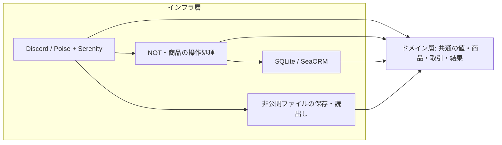

# アーキテクチャ設計

ドメイン層とインフラ層の2層で構成する。独立したアプリケーション層は設けない。層・Trait・DTOは、実際に必要になった時点で追加する。[操作とDBアクセス](REPOSITORY.md)、[DB設計](DATABASE.md)、[コンテンツ売買](CONTENT.md)に対応する。

コードも `src/domain.rs` と `src/infrastructure/` の2層へ整理した。旧 `src/application/` は削除し、既存の操作・検証・取引境界を移設した。現在の配置を末尾に記載する。

## 2層の責務

| 層 | 責務 | 変更の考え方 |
|---|---|---|
| ドメイン | 変換・検証済みの値、商品、取引、操作結果を保持する共通の型。型自体の不変条件を保証する。 | DB列名・SDK・返信形式の変更を波及させない。業務上の値の意味が変わる場合は変更する。 |
| インフラ | 外部形式の解析、ドメイン型の生成、認証、最新状態を使う検証、操作の実行、DB・Discord・ファイルI/O。 | API・DB・操作手順の変更をここで引き受ける。用途ごとにモジュールを分ける。 |

「変更が加わらない」は外部都合で変更しなくてよいという意味とする。ドメイン型を将来の業務仕様まで固定するものではない。

クリーンアーキテクチャの図の層数をそのまま採用する必要はない。このプロジェクトでは、共通型が外部の詳細へ依存しない点を採用し、操作の組み立てもインフラへ置く簡素な構成とする。[原典の層数と依存方向](https://blog.cleancoder.com/uncle-bob/2012/08/13/the-clean-architecture.html)



矢印はコードの依存方向を表す。ドメインはインフラを参照せず、SDK・ORM・接続・HTTPステータスを保持しない。`main.rs` は設定を読み、具体実装を組み立てる入口とする。

## Value Objectと完全コンストラクタ

Value Objectは値を表す型、完全コンストラクタは生成時に必要な値と不変条件を満たすための方法であり、変換専用の層ではない。インフラが外部値を解析し、ドメイン型の検証付きコンストラクタを呼んで変換を完了する。[Value Object](https://martinfowler.com/bliki/ValueObject.html)

| 検証 | 場所と例 |
|---|---|
| 外部形式・外部制約 | インフラ。Discordの文字列から整数への解析、SDKのID変換、Embed全体の上限、添付の実サイズ。 |
| 値単体の不変条件 | ドメイン型のコンストラクタ。`Price > 0`、`Balance >= 0`、IDは正数。インフラから生成しても、この保証を迂回できない。 |
| 所属・権限 | インフラのDiscord処理。入力IDや管理者フラグを信用せず、REST照会から `Actor` を生成する。 |
| 最新状態との照合 | インフラの操作処理。出品者本人、残高不足、商品版、購入済み、返金済み、依頼の重複を同じDB取引内で確認する。 |

フィールドは非公開にし、`TryFrom`・`try_new` などから有効な値だけを生成する。値の更新は新しい値の生成で表す。金額の加減算・符号反転はchecked演算を使う。コンストラクタ内ではDB・ネットワーク・ファイルにアクセスしない。

ドメイン型へSDK・ORM用deriveや、検証を迂回する `Deserialize` は加えない。DBから取得した負の残高などは、入力不正と分けて `DatabaseError::InvalidData` にする。共通型と同じ内容のDB用・API用DTOや専用Mapperは作らない。

## 型と処理の配置

| 配置 | 主な型・処理 |
|---|---|
| ドメインの値・モデル | `Price`、`Balance`、`NotAmount`、各ID、`ItemDetails`、`ContentFile`、`ItemTarget`、`ShopItem`、`LedgerReason`、`LedgerEntry`。 |
| ドメインの入力・結果 | `Actor`、`NewShopItem`、`NewLedgerEntry`、`UserBalance`、`PurchaseQuote`、`PurchaseResult`、`TradeResult`。SDK形式を持たない検証済みのデータ。 |
| インフラのSQLite操作処理 | `NotUseCase`、`ShopUseCase`。既存の操作を再利用し、具体的なSQLite実装を呼ぶ。名前のUseCaseは独立した層を意味しない。 |
| インフラのDB処理 | `SqliteDatabaseAccess`、`SqliteSession`、`DatabaseError`。SeaORMで照会・INSERT・一括確定し、その場で共通型へ変換する。 |
| インフラのDiscord処理 | `discord/`。Poiseのコマンド定義・引数解析・返信を使い、SerenityでREST認証・キャッシュ・権限計算を行う。P08でDM出品・商品公開・再投稿、P09で購入確認・決済・配送・無料再送を接続済み。 |
| インフラのファイル処理 | `store_content`、`StoredContent`。永続保存の成功を表す値は保存処理からだけ生成し、未保存のメタデータで代用しない。 |
| インフラの設定・失敗 | `Config`、`UseCaseError`、ファイルI/Oのエラー。ドメインの金額・値のエラーはドメインに残す。 |

DBはSQLite、DiscordはPoise＋Serenityの具体実装を使う。単一実装のための `DatabaseAccess`・`DatabaseSession` TraitとDBの型引数は削除し、具体型の通常メソッドへ整理した。取引の保証は保持する。`DiscordAccess` Traitも先に作らず、実際に複数実装や共有が必要になった場合に境界を見直す。

## 維持する動作

エラー処理は `?` で呼出し側へ返す形を基本とする。起動・Discord処理には標準の `Box<dyn Error + Send + Sync>` を使い、業務上区別するエラーだけを型として残す。定型的な表示・ラップするだけの型変換は `thiserror` に任せ、DBエラーの分類は `From` に集約する。SDKエラー本文の出力は境界で抑え、個々の処理へエラーログや文字列変換を重ねない。

業務エラーで戻る際の未確定トランザクションはSeaORMのDropに取消を任せる。SQL失敗後の確定拒否、処理中のキャンセル、COMMIT結果不明を扱う既存の取引管理は維持する。

全テーブルはINSERTと履歴で管理し、残高と最新商品はVIEWから求める。変更するのは責務の配置であり、金額・認可・取引の仕様は [REPOSITORY.md](REPOSITORY.md) と [DATABASE.md](DATABASE.md)を引き継ぐ。

- 残高確認から追記まで同じImmediateトランザクションを使い、購入・売上、返金・売上取消を一括確定する。
- 同じ依頼IDでは確定済みの内容を照合し、再課金しない。結果不明なら新しいIDでやり直さない。
- Discord API・ファイルI/OはDBトランザクションの外で実行する。ファイル配送直前に本人・同じギルド・未返金の購入権限を再確認する。
- コンテンツ配送失敗は無料再送で復旧する。自動返金せず、購入履歴と完成ファイルを保持する。P13のロール販売はCOMMIT後に付与・保有照合を行い、未付与を確認できれば返金を試みる。状態不明・返金不能なら購入権限を保持し、再照合・再起動で復旧する。

操作処理とDB処理は同じインフラ層内でも関数・モジュールを分ける。層を減らすためにDiscordイベントへSQLや決済手順をすべて埋め込む必要はない。

## コードの配置

| 場所 | 所属・内容 |
|---|---|
| `src/domain.rs` | ドメイン。共通型・値の不変条件。 |
| `src/infrastructure/sqlite/not.rs`・`shop.rs` | 既存の残高・商品・購入・返金の操作処理。 |
| 各 `mod.rs` | モジュール宣言と型・関数の再公開。実装は役割ごとのファイルへ置く。 |
| `src/infrastructure/sqlite/database.rs`・`001_initial.sql` | SQLite接続・初期化・セッション開始、初期SQL。 |
| `src/infrastructure/sqlite/session.rs` | トランザクションの保持・失敗時の取消・確定。 |
| `src/infrastructure/sqlite/ledger.rs`・`items.rs` | 残高・取引のSQL、商品・公開記録のSQLと行の読出し。 |
| `src/infrastructure/sqlite/rewards.rs`・`002_rewards.sql` | 報酬の処理済み判定・制限・処理結果の追記と既存DBへの移行。 |
| `src/infrastructure/sqlite/error.rs` | DBエラーの分類・変換。 |
| `src/infrastructure/discord/bot.rs` | Poiseの構築、コマンド登録、接続・終了。 |
| `src/infrastructure/discord/data.rs` | Poiseの共有データ・Context。 |
| `src/infrastructure/discord/commands.rs` | `#[poise::command]` による `/not`・`/content add` の定義と操作処理の呼出し。 |
| `src/infrastructure/discord/events.rs` | 接続イベント、ボタンの先行defer・振分けと共通のエラー返信。 |
| `src/infrastructure/discord/services.rs` | 所属・権限の認証、入力の変換、ギルド候補。 |
| `src/infrastructure/discord/content.rs` | 添付取得と非公開ファイルの永続保存・上限付き読出し。 |
| `src/infrastructure/discord/listings.rs` | 出品下書き・確認ボタン・商品公開と既存商品による再投稿。 |
| `src/infrastructure/discord/posting.rs` | DM添付・サーバー選択・フォーム入力を既存の出品プレビューへ接続。 |
| `src/infrastructure/discord/purchases.rs` | 購入確認の消費、決済・結果復元、購入一覧・DM配送・無料再送。 |
| `src/infrastructure/discord/management.rs` | 商品変更・削除・再投稿・返金のPoiseコマンドと既存操作の接続。 |
| `src/infrastructure/discord/rewards.rs` | 投稿・返信・リアクションの所属・Bot・自己操作を照合し、報酬を付与。 |
| `src/infrastructure/discord/roles.rs` | 既存ロールの登録・権限と階層の照合、決済後の付与・保有確認、未付与の返金、起動時の再照合・管理者返金時の解除。 |
| `src/infrastructure/discord/test_support.rs` | 出品・購入のテストで共用するローカルHTTPと実SQLiteの準備。テスト時のみ使用。 |
| `src/infrastructure/config.rs` | 起動設定の読込。 |
| `src/infrastructure/error.rs` | 共通エラーと操作エラー。 |
| `src/infrastructure/stored_content.rs` | `StoredContent` と配送サイズ上限。 |

[JadeMusic](https://github.com/segfau-yama/JadeMusic/tree/main/src)の `commands.rs`・`events.rs`・`services.rs` に合わせ、Discord内を用途で分ける。Poiseのコマンド定義から登録情報を生成し、手書きのサブコマンド振分け・オプション取得・候補返信は持たない。SerenityはPoiseの基盤として引き続き使う。[Poiseのコマンド定義](https://docs.rs/poise/0.7.1/poise/)

現在のファイル構成：

```text
src/
  domain.rs
  infrastructure/
    mod.rs
    config.rs
    error.rs
    stored_content.rs
    sqlite/
      mod.rs
      database.rs
      error.rs
      items.rs
      ledger.rs
      not.rs
      rewards.rs
      session.rs
      shop.rs
      001_initial.sql
      002_rewards.sql
    discord/
      mod.rs
      bot.rs
      commands.rs
      data.rs
      events.rs
      services.rs
      content.rs
      listings.rs
      posting.rs
      purchases.rs
      management.rs
      rewards.rs
      roles.rs
      test_support.rs
  lib.rs
  main.rs
```

`StoredContent` はファイル保存とSQLiteの商品操作が共有するインフラの値なので、`infrastructure/stored_content.rs` に置き、`mod.rs` から再公開する。SQLite側からDiscordモジュールを参照する必要はない。ドメイン型・SQL・取引境界はこの配置変更で書き換えない。

工程・実装済み範囲・検証結果は [IMPLEMENTATION.md](IMPLEMENTATION.md)で確認する。アプリケーション層や追加の抽象化は、操作の共用など実際の変更理由が生じた段階で検討する。
