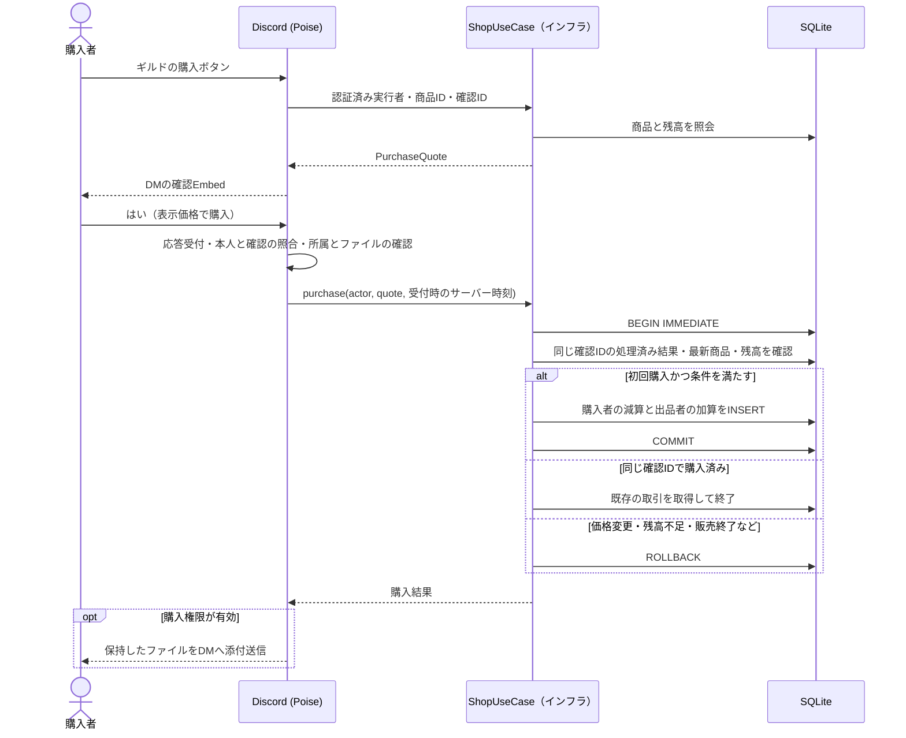

# Discord内でのコンテンツ売買

Webストアを使わず、出品・商品表示・購入確認・ファイル受け取り・再送をDiscord内で完結させる。コンテンツは出品者と購入者の間で対象ギルドのNOTを同額移動する。ロールは購入者のNOTだけを減らし、出品者には加算しない。[DB設計](DATABASE.md)・[ユースケース設計](REPOSITORY.md)・[アーキテクチャ](ARCHITECTURE.md)に対応する。

## レビュー

提案の4段階は実現できる。以下を補って採用する。

| 優先度 | 見直す点 | 採用案 |
|---|---|---|
| 高 | 添付URLだけを商品として保存すると、有効期限や元メッセージの削除に依存する。公開商品に添付すると購入前に取得できてしまう。 | 出品時にBot管理の非公開な永続領域へファイルを保存する。公開するのは商品情報だけ。 |
| 高 | DMからは所属ギルド・権限を確定できない。入力された `guild` や商品IDだけでは認可できない。 | Botの参加・実行者の所属と出品／購入の許可を確認し、商品・残高・確認画面を同じギルドへ結び付ける。 |
| 高 | 確認後の価格変更や二重クリックで、意図しない金額・複数回の課金が発生し得る。 | 価格と商品版を確認画面へ固定し、変更時は再確認する。確認IDを単位に売買2行を一括確定する。 |
| 高 | 決済とDM送信は同時に確定できず、決済後に送信だけ失敗する。 | 購入権限を履歴として残す。配送保留として案内し、追加課金なしで再送する。送信結果不明時は自動返金しない。 |
| 中 | 長いコマンドは、出品先の指定やファイル添付で迷いやすい。 | DMへのファイル送信・サーバー選択・入力フォームを主な入口にし、コマンドも残す。 |

## 1. 出品

初期仕様は1商品につき1ファイル。複数ファイルは出品者が1つのアーカイブにまとめる。内容の差し替えは別商品として扱い、既存購入者が受け取るファイルを変えない。

コマンドの例：

```text
/content add title:資料集 description:使い方をまとめたPDF price:500 guild:対象サーバー file:資料.pdf
```

`file` はDiscordの添付オプション、`guild` は出品先サーバーの候補から選ぶ。`/content` はグローバル登録し、サーバー追加・ユーザー追加の両方と、BotとのDMコンテキストを有効にする。候補に表示されない場合はアプリのUser Installを有効にし、本人のアカウントへ追加してDMを開き直す。実行時の対象サーバーへの所属・権限照合は維持する。ギルド限定コマンドはDMで使えない。[Discordのコマンド仕様](https://docs.discord.com/developers/interactions/application-commands)

コマンドなしの入口は次の流れとする。

1. BotとのDMへファイルを1つ送る。
2. Botが「このファイルを出品する」ボタンを返す。ファイルを送っただけでは公開しない。
3. 出品可能なサーバーを選ぶ。候補が多ければ検索・ページ分割する。
4. 「商品名」「説明」「価格」の入力フォームを開く。
5. サーバー名・ファイル名・価格を含むプレビューで「出品する」を押す。

ギルドの商品案内には購入ボタンだけを置く。出品はBotとのDMへのファイル送信か `/content add` から始める。

Discord APIにはモーダル内のファイルアップロードもある。採用するSerenityの対応状況を確認できたら、フォームへの添付にまとめる代替案になる。最初はDM添付と通常の入力フォームを使い、独自のフォーム機構は作らない。[Discordのフォーム部品](https://docs.discord.com/developers/components/reference#file-upload)

プレビューは実行者に結び付けた期限付きの下書きとする。Bot再起動・期限切れなら未確定の出品をやり直す。保存キーは出品操作のIDに結び付け、同じ操作の再試行では変えない。ファイル保存 → 商品・初版・ファイル情報のDB確定 → ギルドへの投稿の順に進める。確定済みなら既存の商品を返し、公開投稿に失敗しても商品を重複作成せず、商品IDと再投稿ボタンを案内する。

P08では下書きを本人ごとに1つ、5分間メモリに保持する。新しい `/content add` は以前の下書きを失効させる。確認・取消時は本人の下書きを取り出してから外部I/Oを行い、二重クリックで同じ処理を並行開始しない。失敗時は期限内かつ新しい下書きがなければ同じ操作IDで再試行できる。再投稿ボタンはギルド・商品IDから本人の所属と出品者を再確認し、保存済み商品を公開する。P11では商品ごとのロックで変更・削除・公開を直列化し、DBセッションを保持してDiscord APIを待たない。

P10の添付入力も本人ごとに1つ・5分間のメモリ保持とする。新しい添付で古い入力とプレビューを失効させ、フォーム送信時に所属・出品先・入力値を照合してP08の `ListingDraft` と同じプレビューへ渡す。保存操作IDはDM添付のメッセージIDを使い、保存・商品作成・公開はP08の処理へ合流する。設定済みサーバーを25件ずつ照合するページ切替を持ち、本人が所属する候補だけを表示する。サーバー選択からのモーダル表示は初回応答、所属照合を行う一覧表示・フォーム送信は先にdeferする。

## 2. ギルドの商品投稿

管理者が指定した販売チャンネルへ、Embedと購入ボタンを投稿する。

```text
資料集
使い方をまとめたPDF
価格：500 NOT
出品者：出品者名
ファイル：資料.pdf（2.4 MiB）
対象サーバー：サーバー名
[購入する]
```

ファイル本体・保存キー・元の添付URLは公開しない。タイトル・説明はEmbedの長さ制限内で検証し、ユーザー入力による不要なメンションを抑止する。

Embed＋ボタンには従来のAction Rowを使い、`IS_COMPONENTS_V2` は付けない。Components V2を有効にしたメッセージでは `embeds` が使えなくなる。[Discordのメッセージ部品](https://docs.discord.com/developers/components/reference)

商品変更・削除ではDBへ新版を追記し、公開メッセージの内容・ボタンを編集する。投稿・編集は商品ごとに直列化し、DBの最新状態から表示を作る。DBのINSERT限定方針はDiscord上のメッセージ編集を禁止するものではない。公開メッセージは表示用であり、購入可否と価格は必ずDBの最新状態で判断する。

P11の操作はDMの `/content update`・`delete`・`republish`・`refund`。変更・削除は商品IDと期待する版を指定する。再投稿では最新記録のメッセージを編集し、DiscordのUnknown Messageだけは新しい投稿で復旧する。販売終了の商品も削除版の表示を同期し、購入ボタンを無効化する。Botは同じDBに対して1プロセスで運用する。返金にはNOT管理権限を要求し、購入IDとInteraction IDをP06へ渡す。

## 3. 購入確認のDM

ギルドの購入ボタンを押した時点では課金しない。本人にだけ見える応答を返し、DMへ次の確認を送る。

```text
「資料集」を購入しますか？
サーバー：サーバー名
出品者：出品者名
価格：500 NOT
現在の残高：1,200 NOT
購入後の残高：700 NOT
確認期限：5分
[はい（500 NOTで購入）] [いいえ]
```

DMを送れない場合はギルド側の本人向け応答で案内し、課金しない。残高不足・自己購入・販売終了なら確認を発行しない。購入済みなら「購入済み・ファイルを再送する」を案内する。

`PurchaseQuote` は確認ID・購入者ID・ギルドID・商品ID・商品版・価格・有効期限を持つ。ボタンには確認IDだけを入れ、金額やユーザーIDを入力値として信用しない。DMでも元の商品に属するギルドの残高を使う。

P05の実装では商品スナップショットにギルド・商品ID・版・価格を保持する。確認発行と決済の受付時刻は呼び出し側が採取した `SystemTime` を渡す。発行受付から300秒で失効し、未処理なら期限ちょうどでも拒否する。時刻を利用者の入力から作らない。

未確定の確認は期限付きのメモリ上の状態で十分とする。再起動後の未購入の確認は失効させる。確定済みの取引は `find_purchase_by_confirmation` で購入者と同じ確認IDを照合でき、再起動を理由に再課金しない。未確定の確認が見つからず、確定済み取引もなければ確認を作り直す。

「はい」「いいえ」は、確認状態を受付中から処理中・取消へ一度だけ切り替えて扱う。「いいえ」や期限切れでは取引行を追加しない。決済が確定した後の「いいえ」は返金操作にしない。

P09では確認IDを `ギルドID-購入ボタンのInteraction ID` とし、DMボタンにはこの確認IDと操作だけを持たせる。本人照合後にメモリから取り出して処理し、ロックを保持して外部I/Oを行わない。決済結果が不明なら同じ確認IDの結果照合へ戻し、確認状態の再作成や再決済は行わない。購入一覧は5件ずつ表示し、各購入IDの無料再送ボタンを付ける。

## 4. 決済とファイル送信



- ボタン・フォーム送信は3秒以内に応答する。時間のかかる保存・決済・配送はdefer後に行う。モーダルを開く場合はモーダル自体を初回応答とする。対話トークンの有効期間と購入確認の期限は別で、再起動後もトークンを保管して配送し続ける設計にはしない。[Discordの応答期限](https://docs.discord.com/developers/interactions/receiving-and-responding)
- 購入者本人、対象ギルドへの所属、ファイルを読み出せること、BotがDMへ再送できるサイズであることを、決済前に確認する。Discord APIやファイル読出しはDBトランザクションの外で行う。
- `BEGIN IMMEDIATE` 内で、同じ確認IDの処理済み取引 → 商品の販売状態・版・価格 → 自己購入・購入済み → 両者の残高と算術、の順に照合する。価格・版が変わっていたら課金せず、新しい条件での確認へ戻す。
- イベントキーは `content:{quote_id}:buyer`・`content:{quote_id}:seller` とする。ボタンクリックごとのInteraction IDを決済キーにしない。同じ確認IDは両行の一意制約で重複を防ぎ、別の確認IDによる同時購入も未返金の購入履歴で防ぐ。
- 初回の購入可否・期限の検証より先に、同じ確認IDで確定済みかを調べる。購入後の価格変更・期限切れ・商品削除が、処理済み結果の照合や有効な購入権限による再送を妨げないようにする。返金済みの確認IDも再課金に使わず、再送権限は未返金かを別途確認する。
- COMMIT後にDiscord側の処理がファイルをDMへ送る。`ShopUseCase.purchase` は取引結果と現在の商品を返す。配送の直前にはP06の `get_content_for_purchase` で購入権限を確認し、購入結果だけで配送を許可しない。ファイル送信結果を取引失敗として扱わない。P13のロール商品も同じ確認・決済を使い、未返金の権利を `get_purchase` で照合してSerenityから付与する。未付与を確認した場合の返金と、保有不明・返金不能時の再照合は `services.rs` で扱い、ファイルの無料再送とは分ける。
- 決済後の送信失敗・結果不明は `DeliveryPending` と購入IDを案内する。DMにも応答できない場合は次回の操作で購入済み状態を表示する。送れたか不明な場合に、返金や再購入を自動実行しない。
- 「購入したもの」ボタンまたは `/content purchases guild:対象サーバー` で購入一覧を開き、「再送する」を押せるようにする。購入履歴・購入者・未返金を再検証し、追加課金しない。再送が重複する場合はあっても、課金は重複させない。
- 返金は認可された明示操作として扱う。従来どおり購入者への返金と出品者の売上取消を一括追記する。出品者の残高不足なら返金できないため、DM失敗時の即時返金は保証しない。

P06の返金は既存のNOT管理権限を持つ実行者だけが行う。イベントキーは `refund:{request_id}:buyer`・`refund:{request_id}:seller` とし、同じ依頼の再試行では同じIDを使う。同じ購入・同じ依頼IDなら元の履歴を返し、別IDでの二重返金を拒否する。商品削除・価格変更後も元の購入額で返金する。

P13のロール購入は `content:{quote_id}:buyer` の1行だけを記録し、出品者本人の購入も代金を減算する。確認DMの購入後残高にも減算後の額を表示する。返金は購入者への1行だけで、出品者の残高には依存しない。変更前の売上付きロール購入は既存履歴を保持し、返金時も元の売上を取り消す。二重課金防止・購入一覧・再起動後の復旧は共通の購入処理を使う。

確認IDからの領収結果の復元、購入一覧と再送用ファイル情報の照会は課金行を追加しない。一覧は本人・ギルドの未返金購入だけを購入IDの降順で返す。復元した領収結果は返金済みでも取得できるが、配送用ファイル情報は未返金の購入者だけに返す。実ファイルの読取りとDiscordへの送信はP09で接続済みで、送信の直前にこの権限を照合する。

## ファイルの保持

最初はBotの永続ディスクへ保存し、DBには `content_file` のキー・元のファイル名・サイズを記録する。外部ストレージ用の抽象化・公開ダウンロード用APIは追加しない。DBとファイルをバックアップ対象にし、商品削除後も既存購入者向けに保持する。

Discordの添付CDN URLには有効期限があるため、URLを永久的な取得先としない。[Discordの添付URL仕様](https://docs.discord.com/developers/reference#signed-attachment-cdn-urls)

受け付けるのはDiscordが添付として返したファイルだけとし、メッセージ本文の任意URLは取得しない。実データをサイズ上限付きで読み取り、Bot生成の保存キーで保持する。ユーザーのファイル名を保存パスに使わず、内容を実行・自動展開しない。

出品時にはユーザー側のアップロード上限ではなく、Botが購入者のDMへ再送できる上限に収める。Discordのファイル上限・リクエスト全体の上限を確認して出品を受け付け、送信できないサイズのファイルは公開しない。[Discordのファイル仕様](https://docs.discord.com/developers/reference#uploading-files)、[メッセージ送信仕様](https://docs.discord.com/developers/resources/message#create-message)

P04の実装は1バイト〜20 MiBの単一ファイルを受け付ける。2026-10-19確認のDiscordの既定上限20 MiBを採用し、25 MiBのリクエスト上限に対して余地を残す。元ファイル名はUTF-8で255バイト以内。ギルドの増枠や出品者のNitroによる上限は使わない。実際のDM配送と配送直前の再確認はP09で行う。[Discordのファイル上限](https://docs.discord.com/developers/reference#uploading-files)、[送信リクエスト上限](https://docs.discord.com/developers/resources/message#create-message)

保存キーは `content-{guild_id}-{user_id}-{request_id}` とし、操作IDはBotが発行する1〜128文字のASCII英数字・ハイフン・アンダースコア。同じ下書きの再試行では同じIDを使う。保存先はBotだけが書き込む非公開ディレクトリとし、元ファイル名や外部のパスを保存先にしない。POSIXの永続ディスクで、一時ファイルを排他的に作成して書き込みと同期を完了し、ハードリンクで完成パスを上書きせずに確定する。同じキーの既存ファイルは通常ファイル・同一内容だけを許可し、シンボリックリンクを拒否する。

ファイルの永続保存を先に完了し、その後に商品をDBへ確定する。DB確定前に失敗した一時ファイルは破棄できるが、商品として確定したファイルは上書きしない。購入者に送ったファイルの回収・転送制限はできない。返金で停止できるのは以後のBotからの再送である。

保存処理が返す `StoredContent` を商品作成へ渡し、ユースケースは保存したユーザー・ギルドを照合する。商品削除後もファイルを保持する。DB確定に失敗した場合も完成ファイルは残して同じキーで再試行する。プロセス強制終了で残る `.pending-*` と未登録の完成ファイルの自動清掃は追加しない。

## 最小の構成と検証点

- [2層の設計](ARCHITECTURE.md)に従い、ドメインは共通型、インフラは変換・検証・操作・I/Oを担当する。`ShopUseCase` はインフラ内の操作処理であり、独立したアプリケーション層ではない。コードもこの2層へ移行済み。
- UIは `discord/commands.rs`、イベントは `events.rs`、共有の認証・変換は `services.rs`、ファイル保存は `content.rs` に置く。PoiseとSerenityを使い、Web・OAuth・専用のMapperは追加しない。
- 購入・認可・金額・版の照合は `ShopUseCase`、SQL・SeaORMのモデルは既存のDB実装に置く。
- 商品説明、ファイル情報、公開メッセージの記録をDBへ加える。下書き・未決済の確認・配送状態の専用テーブルは作らず、確定済みの購入履歴から再送権限を求める。
- 対象チャンネルは初期設定でギルドごとに指定する。Botの閲覧・投稿・Embed権限を確認する。一般ユーザーにチャンネルの管理権限は要求しない。

実装時の必須確認は、別ギルド・別ユーザーによる操作拒否、二重クリック・別確認からの同時購入、価格変更時の再確認、決済途中のロールバック、DM拒否時の課金なし、決済後の配送失敗と無料再送、Bot再起動、商品削除・返金後の再送権限である。

<!-- ponytail: 未決済の下書き・確認はメモリ保持で、Bot再起動時は入力し直す。配送の自動復旧キューは作らず、永続化済み購入履歴からの手動再送を入口にする。 -->
