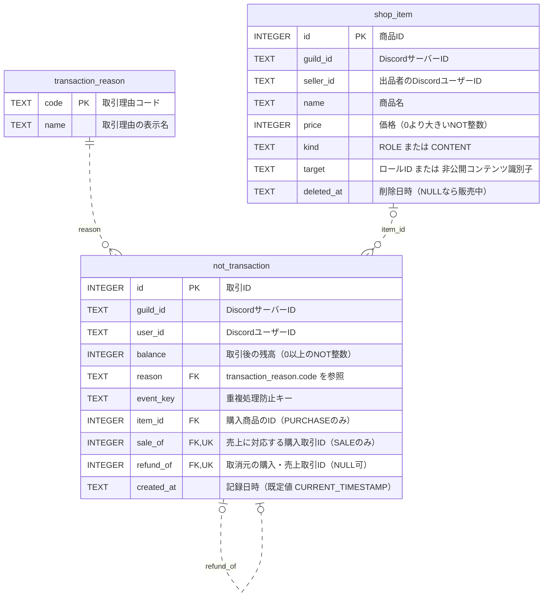

# データベース設計

[共有チャット](https://chatgpt.com/share/6ad1b83e-7b28-83ee-beda-cb7347a52b33)を基に、取引後の残高を履歴として保存するSQLiteの3テーブル案。DiscordロールとWebコンテンツのユーザー間売買に対応し、購入者から出品者へ同額のNOTを移す。



## 取引理由マスタ

`not_transaction.reason` は `TEXT NOT NULL REFERENCES transaction_reason(code)` として定義する。各DB接続で `PRAGMA foreign_keys = ON` を設定し、マスタに存在しない理由コードの記録を拒否する。コードは固定し、表示名だけを変更できる。

```sql
CREATE TABLE transaction_reason (
    code TEXT PRIMARY KEY NOT NULL,
    name TEXT NOT NULL
);

INSERT INTO transaction_reason (code, name) VALUES
    ('MESSAGE', 'メッセージ投稿'),
    ('REACTION', 'リアクションする'),
    ('REACTION_RECEIVED', 'リアクションされる'),
    ('REPLY_RECEIVED', '返信される'),
    ('TIP_SENT', 'NOT譲渡'),
    ('TIP_RECEIVED', 'NOT受取'),
    ('TIMEOUT', 'ルール違反による減算'),
    ('PURCHASE', '商品購入'),
    ('SALE', '商品売上'),
    ('REFUND', '購入者への返金'),
    ('SALE_REFUND', '出品者の売上取消'),
    ('ADJUSTMENT', '管理者による残高調整');
```

マスタの追加・変更は運営側の管理処理に限定する。理由ごとの報酬額は、譲渡額や商品価格などで変わるため、このマスタには持たせない。

## 制約と残高管理

- `item_id`・`sale_of`・`refund_of`・`deleted_at` 以外は必須。`shop_item.deleted_at` の既定値はNULL。
- 下表の参照列の組み合わせをCHECK制約で保証する。参照先の理由・サーバー・ユーザーの一致は、取引を行う同じDBトランザクション内で検証する。

| 理由 | 残高を記録するユーザー | `item_id` | `sale_of` | `refund_of` |
|---|---|---|---|---|
| `PURCHASE` | 購入者 | 商品ID | NULL | NULL |
| `SALE` | 出品者 | NULL | 購入取引ID | NULL |
| `REFUND` | 購入者 | NULL | NULL | 購入取引ID |
| `SALE_REFUND` | 出品者 | NULL | NULL | 売上取引ID |
| その他 | 対象ユーザー | NULL | NULL | NULL |

- 複合一意制約は `shop_item(guild_id, kind, target)` と `not_transaction(guild_id, event_key)`。
- `sale_of` と `refund_of` は、それぞれNULL以外の値を一意にする。1つの購入への二重の売上加算と、購入・売上それぞれへの二重取消を防ぐ。どちらも `not_transaction.id` を参照する外部キー。
- 購入時は商品のサーバー・未削除であること・出品者・現在価格を取得し、自己購入と購入者の残高不足を拒否する。購入者の減算行と出品者の加算行を同じDBトランザクションでINSERTし、`SALE.sale_of` に購入行のIDを記録する。手数料は設けず、両者の増減額の合計を0にする。
- 返金時は元の購入が同じサーバー・購入者の `PURCHASE` であることと、それに対応する `SALE`・出品者を確認する。購入時の価格を出品者から購入者へ戻し、`REFUND` と `SALE_REFUND` の2行を同じDBトランザクションでINSERTする。出品者の残高不足時は両者の残高を変えずエラーとする。
- 商品の `guild_id` と `seller_id` は固定する。販売済み商品の `kind`・`target` も変更せず、変更が必要なら別の商品として登録する。商品名・価格は変更できるが、過去の購入額は取引時点の残高差から求める。
- 商品削除は `deleted_at` に日時を設定する論理削除とする。行と取得先のコンテンツは保持し、削除後も既存購入者の閲覧・ロール照合・返金に使えるようにする。一覧表示と新規購入は未削除の商品だけを対象とする。
- 取引履歴はINSERTのみで追記する。`balance` は各取引の直後の残高で、`(guild_id, user_id)` ごとの `id` が最大の行を現在残高とする。履歴がなければ0NOTとし、`CHECK (balance >= 0)` で負の残高を禁止する。
- SQLiteの `BEGIN IMMEDIATE` 内で、イベントの未処理確認・最新残高の取得・残高不足の検証・新しい残高のINSERTを行う。譲渡・購入・返金では両者を同じDBトランザクションで記録する。
- `event_key` は操作種別と依頼IDを含める。譲渡では `:sent`・`:received`、購入・返金では `:buyer`・`:seller` を付けて各行を区別し、再試行時も同じキーを使う。
- 取引の増減額は、同じサーバー・ユーザーの直前の残高との差で求める（初回の直前残高は0）。返金額も元の購入取引の残高差から求め、現在の商品価格は使用しない。
- 購入済み判定には、返金されていない `PURCHASE` 取引を使う。ユーザー情報はDiscordで管理し、独自のユーザー・残高・購入履歴テーブルは設けない。

現在残高の取得SQL（検索用インデックスは `(guild_id, user_id, id)`）：

```sql
SELECT COALESCE((
    SELECT balance
    FROM not_transaction
    WHERE guild_id = ? AND user_id = ?
    ORDER BY id DESC
    LIMIT 1
), 0) AS balance;
```

## 正規化の確認

- **取引理由**：`code → name` の対応を `transaction_reason` に集約する。取引履歴に理由の表示名を複製しない。
- **商品**：出品者・商品名・現在価格・種別・取得先は `shop_item` に集約し、購入行には商品IDを持たせる。サーバー・種別・取得先の組で商品を識別できるため、ロール用・コンテンツ用のテーブル分割は現時点では不要。
- **残高履歴**：`balance` は各取引時点の値で、取引IDに依存する。同じユーザーでも取引ごとに値が異なるため、ユーザー情報として分離しない。現在残高は最新行から取得する。
- **売上・返金**：売上の商品は `sale_of`、返金の商品は `refund_of` の参照先をたどって取得し、商品IDを重複保存しない。一方、各行のサーバーIDや取消行のユーザーIDは、残高検索を統一するため参照先と重なる情報を意図的に保持する。上記の一致検証で不整合を防ぐ。

各列は単一の値を持ち、理由・商品・取引の情報も分離している。共通の残高履歴として保持する識別情報には上記の冗長性があるため、設計全体を厳密な第3正規形と断定せず、この重複と整合性の条件を明示して運用する。
