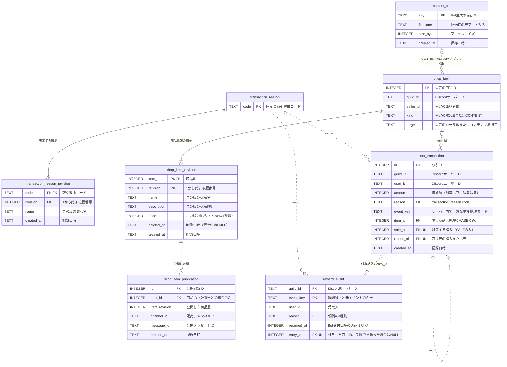

# データベース設計

NOTの増減・商品・取引理由を、すべてINSERTで保存するSQLite設計。既存行へのUPDATE・DELETE・REPLACEは使わない。商品の更新・削除と理由の表示名変更は履歴の追記で表し、現在の状態はVIEWで取得する。Discordのユーザー情報は保存しない。コンテンツは[Discord内の購入フロー](CONTENT.md)で売買する。

## テーブルと参照

固定の識別情報・変更履歴・添付ファイル・公開投稿・報酬の処理結果を分けた8テーブルと、照会用の3つのVIEWを使う。

実装SQLは [001_initial.sql](../src/infrastructure/sqlite/001_initial.sql) と [002_rewards.sql](../src/infrastructure/sqlite/002_rewards.sql)。起動時に `SqliteDatabaseAccess::open` が適用する。現在のSQLiteの `user_version` は2。新規DBは両SQLと版番号を同じImmediateトランザクションで確定し、既存の版1には報酬の処理結果と索引だけを追加する。ファイルヘッダの版管理であり、業務テーブルの既存行は書き換えない。[SQLiteのuser_version](https://www.sqlite.org/pragma.html#pragma_user_version)



VIEWは `current_transaction_reason`（理由の最新表示名）、`current_shop_item`（削除済みを含む商品の最新状態）、`not_balance`（サーバー・ユーザーごとの残高）。VIEWから履歴テーブルへの書き戻しは行わない。

`not_transaction.id` は追記APIがSQLiteの自動採番を使い、追記順に増加させる。残高調整の再試行では、このIDまでの履歴合計で当時の目標残高を照合する。既存行の削除や任意IDでの挿入は通常操作に含めない。最大IDが `i64::MAX` に到達した後は、SQLiteが小さいIDをランダムに採番する動作を避けるため、追記APIがINSERTを拒否する。テーブル定義の変更や `AUTOINCREMENT` の追加はしない。[SQLiteのROWID採番](https://www.sqlite.org/autoinc.html)

## テーブル定義

以下の接続設定は各DB接続で適用する。履歴の変更を行うAPIは作らず、運営の管理処理も追記で行う。`INSERT OR REPLACE` も既存行を置き換えるため使わない。

```sql
PRAGMA foreign_keys = ON;
BEGIN IMMEDIATE;

CREATE TABLE transaction_reason (
    code TEXT PRIMARY KEY NOT NULL
);

CREATE TABLE transaction_reason_revision (
    code TEXT NOT NULL REFERENCES transaction_reason(code),
    revision INTEGER NOT NULL CHECK (typeof(revision) = 'integer' AND revision > 0),
    name TEXT NOT NULL CHECK (length(trim(name)) > 0),
    created_at TEXT NOT NULL DEFAULT CURRENT_TIMESTAMP,
    PRIMARY KEY (code, revision)
);

CREATE TABLE content_file (
    key TEXT PRIMARY KEY NOT NULL,
    filename TEXT NOT NULL CHECK (length(filename) > 0),
    size_bytes INTEGER NOT NULL CHECK (typeof(size_bytes) = 'integer' AND size_bytes > 0),
    created_at TEXT NOT NULL DEFAULT CURRENT_TIMESTAMP
);

CREATE TABLE shop_item (
    id INTEGER PRIMARY KEY,
    guild_id TEXT NOT NULL,
    seller_id TEXT NOT NULL,
    kind TEXT NOT NULL CHECK (kind IN ('ROLE', 'CONTENT')),
    target TEXT NOT NULL,
    UNIQUE (guild_id, kind, target)
);

CREATE TABLE shop_item_revision (
    item_id INTEGER NOT NULL REFERENCES shop_item(id),
    revision INTEGER NOT NULL CHECK (typeof(revision) = 'integer' AND revision > 0),
    name TEXT NOT NULL CHECK (length(trim(name)) > 0),
    description TEXT NOT NULL DEFAULT '',
    price INTEGER NOT NULL CHECK (typeof(price) = 'integer' AND price > 0),
    deleted_at TEXT,
    created_at TEXT NOT NULL DEFAULT CURRENT_TIMESTAMP,
    PRIMARY KEY (item_id, revision)
);

CREATE TABLE shop_item_publication (
    id INTEGER PRIMARY KEY,
    item_id INTEGER NOT NULL,
    item_revision INTEGER NOT NULL,
    channel_id TEXT NOT NULL,
    message_id TEXT NOT NULL,
    created_at TEXT NOT NULL DEFAULT CURRENT_TIMESTAMP,
    FOREIGN KEY (item_id, item_revision)
        REFERENCES shop_item_revision(item_id, revision),
    UNIQUE (item_id, item_revision, channel_id, message_id)
);

CREATE INDEX shop_item_publication_item_idx
    ON shop_item_publication (item_id, id);

CREATE TABLE not_transaction (
    id INTEGER PRIMARY KEY,
    guild_id TEXT NOT NULL,
    user_id TEXT NOT NULL,
    amount INTEGER NOT NULL CHECK (typeof(amount) = 'integer'),
    reason TEXT NOT NULL REFERENCES transaction_reason(code),
    event_key TEXT NOT NULL,
    item_id INTEGER REFERENCES shop_item(id),
    sale_of INTEGER UNIQUE REFERENCES not_transaction(id),
    refund_of INTEGER UNIQUE REFERENCES not_transaction(id),
    created_at TEXT NOT NULL DEFAULT CURRENT_TIMESTAMP,
    UNIQUE (guild_id, event_key),
    CHECK (
        (reason = 'PURCHASE' AND amount < 0 AND item_id IS NOT NULL
            AND sale_of IS NULL AND refund_of IS NULL)
        OR (reason = 'SALE' AND amount > 0 AND item_id IS NULL
            AND sale_of IS NOT NULL AND refund_of IS NULL)
        OR (reason = 'REFUND' AND amount > 0 AND item_id IS NULL
            AND sale_of IS NULL AND refund_of IS NOT NULL)
        OR (reason = 'SALE_REFUND' AND amount < 0 AND item_id IS NULL
            AND sale_of IS NULL AND refund_of IS NOT NULL)
        OR (reason IN ('MESSAGE', 'REACTION', 'REACTION_RECEIVED',
                      'REPLY_RECEIVED', 'TIP_RECEIVED') AND amount > 0
            AND item_id IS NULL AND sale_of IS NULL AND refund_of IS NULL)
        OR (reason = 'TIP_SENT' AND amount < 0
            AND item_id IS NULL AND sale_of IS NULL AND refund_of IS NULL)
        OR (reason = 'TIMEOUT' AND amount <= 0
            AND item_id IS NULL AND sale_of IS NULL AND refund_of IS NULL)
        OR (reason = 'ADJUSTMENT'
            AND item_id IS NULL AND sale_of IS NULL AND refund_of IS NULL)
    )
);

CREATE INDEX not_transaction_balance_idx
    ON not_transaction (guild_id, user_id);

CREATE TABLE reward_event (
    guild_id TEXT NOT NULL,
    event_key TEXT NOT NULL,
    user_id TEXT NOT NULL,
    reason TEXT NOT NULL REFERENCES transaction_reason(code)
        CHECK (reason IN ('MESSAGE', 'REACTION', 'REACTION_RECEIVED', 'REPLY_RECEIVED')),
    received_at INTEGER NOT NULL CHECK (typeof(received_at) = 'integer' AND received_at >= 0),
    entry_id INTEGER UNIQUE REFERENCES not_transaction(id),
    PRIMARY KEY (guild_id, event_key)
);

CREATE INDEX reward_event_limits_idx
    ON reward_event (guild_id, user_id, reason, received_at)
    WHERE entry_id IS NOT NULL;

INSERT INTO transaction_reason (code) VALUES
    ('MESSAGE'), ('REACTION'), ('REACTION_RECEIVED'), ('REPLY_RECEIVED'),
    ('TIP_SENT'), ('TIP_RECEIVED'), ('TIMEOUT'), ('PURCHASE'), ('SALE'),
    ('REFUND'), ('SALE_REFUND'), ('ADJUSTMENT');

INSERT INTO transaction_reason_revision (code, revision, name) VALUES
    ('MESSAGE', 1, 'メッセージ投稿'),
    ('REACTION', 1, 'リアクションする'),
    ('REACTION_RECEIVED', 1, 'リアクションされる'),
    ('REPLY_RECEIVED', 1, '返信される'),
    ('TIP_SENT', 1, 'NOT譲渡'),
    ('TIP_RECEIVED', 1, 'NOT受取'),
    ('TIMEOUT', 1, 'ルール違反による減算'),
    ('PURCHASE', 1, '商品購入'),
    ('SALE', 1, '商品売上'),
    ('REFUND', 1, '購入者への返金'),
    ('SALE_REFUND', 1, '出品者の売上取消'),
    ('ADJUSTMENT', 1, '管理者による残高調整');

COMMIT;
```

`reason` は固定のマスタコードを参照し、存在しない理由をFKで拒否する。表示名は履歴に追記できる。新しい業務理由の追加時は、マスタだけでなく符号・参照列のCHECK制約と業務処理も対応させる。報酬額・商品価格はこのマスタに持たせない。

## 現在の状態を取得するVIEW

```sql
CREATE VIEW current_transaction_reason (code, revision, name) AS
SELECT r.code, r.revision, r.name
FROM transaction_reason_revision AS r
WHERE r.revision = (
    SELECT MAX(h.revision) FROM transaction_reason_revision AS h
    WHERE h.code = r.code
);

CREATE VIEW current_shop_item
    (id, guild_id, seller_id, kind, target, revision, name, description, price, deleted_at) AS
SELECT i.id, i.guild_id, i.seller_id, i.kind, i.target,
       r.revision, r.name, r.description, r.price, r.deleted_at
FROM shop_item AS i
JOIN shop_item_revision AS r ON r.item_id = i.id
WHERE r.revision = (
    SELECT MAX(h.revision) FROM shop_item_revision AS h
    WHERE h.item_id = i.id
);

CREATE VIEW not_balance (guild_id, user_id, balance) AS
SELECT guild_id, user_id, SUM(amount)
FROM not_transaction
GROUP BY guild_id, user_id;
```

最新版は日時ではなく識別子ごとの最大 `revision` で決める。同時刻の記録でも一意に決まる。各版は差分ではなく、名前・価格などその版の完全な状態を保持する。

SQLiteの型親和性だけでは小数の版番号を拒否できないため、`revision` にも `typeof(...) = 'integer'` のCHECKを付ける。

残高取得SQL。履歴がないユーザーはVIEWに行がないため0を返す。

```sql
SELECT COALESCE((
    SELECT balance FROM not_balance
    WHERE guild_id = ? AND user_id = ?
), 0) AS balance;
```

VIEWは保存済み残高やキャッシュではなくSELECTの定義で、参照時に履歴を集計する。VIEW自体には残高不足や出品者本人かを判定する機能はない。[SQLiteのVIEW仕様](https://www.sqlite.org/lang_createview.html)

## 追記の単位と業務上の制約

- 商品作成では `shop_item` と初版 `shop_item_revision` を同一トランザクションでINSERTする。理由の新規登録も固定コードと初版をまとめて記録する。初版のない識別行は確定しない。
- 商品名・説明・価格の変更は最新状態を取得し、版番号を1増やした行をINSERTする。削除は名前・説明・価格を引き継いで `deleted_at` を設定した新版をINSERTする。削除済みの商品は再変更せず、再度の削除は成功として扱う。
- 商品のサーバー・出品者・種別・取得先は初版から固定する。変更が必要なら別商品として登録する。同じサーバー・種別・取得先は削除後も同じ商品に対応し、再登録しない。取得先のコンテンツは既存購入者のため保持する。
- 理由の表示名変更は `transaction_reason_revision` に次の版を追記する。履歴表示は現在の表示名を使う。取引時点の表示名の固定は要件に含めない。
- 商品・理由の版追加は `BEGIN IMMEDIATE` 内で最新版を読み、次の版をINSERTする。版番号の複合主キーで重複を拒否する。商品変更では認証済みの出品者、理由変更では運営権限を確認する。
- 購入は販売中の商品・同じサーバー・自己購入でないこと・未購入を検証し、購入者の `PURCHASE`（負数、`item_id`）と出品者の `SALE`（同額の正数、`sale_of`）を一括INSERTする。2行の合計は0とする。
- 返金は元の購入・売上の符号を反転した `REFUND`・`SALE_REFUND` を追記する。`refund_of` はそれぞれ元の取引を参照する。出品者の残高不足時は両方とも記録しない。現在の商品価格は使わない。
- `sale_of` は同じサーバーの `PURCHASE`、`REFUND.refund_of` は同じ購入者の `PURCHASE`、`SALE_REFUND.refund_of` は同じ出品者の `SALE` を参照する。商品のサーバー・出品者と金額の一致もユースケースが同一トランザクションで検証する。FKだけではこれらの一致までは保証しない。
- `sale_of`・`refund_of` の一意制約で二重売上・二重取消を防ぐ。購入権限は返金されていない `PURCHASE` から判定し、削除済み商品でも既存の権限・返金・ロール照合に使う。
- 罰則は残高を下限0まで減らす。差額0の調整や残高0での罰則も0の取引として記録し、同じイベントの再処理を防ぐ。
- `event_key` は操作種別・依頼IDを含める。譲渡は `:sent`・`:received`、購入・返金は `:buyer`・`:seller` で2行を区別し、再試行時も同じキーを使う。

すべての残高変更は、`BEGIN IMMEDIATE` → 重複確認 → VIEWから残高取得 → 残高不足・オーバーフロー等の検証 → INSERT → COMMITの順とする。失敗時は全体をROLLBACKする。2つのINSERTを別々に確定すると片側だけの取引が残り得る。残高100を別々に確認した2件が各80を引けば、VIEWの結果は−60になるため、集計の採用後も同じトランザクション内での検証が必要。[SQLiteのトランザクション仕様](https://www.sqlite.org/lang_transaction.html)

<!-- ponytail: SQLiteの単一ライタで書き込みを直列化する。競合が実測で問題になったら、別DBで同じ整合性契約を実装する。 -->

## 報酬の処理結果

`reward_event` は付与と制限による見送りの両方をINSERTで記録する。`entry_id` がNULLなら見送り、付与なら同じトランザクションで記録した報酬の取引を参照する。報酬額は投稿5・リアクション実行1・リアクション受信10・返信受信20 NOT。旧仕様で付与済みの1 NOTは履歴を変更せず、再試行でも元の額を返す。返信・リアクションの各受取人は独立して判定する。

`received_at` はBotの受付時刻をUnixミリ秒で保存する。サーバー・受取人・報酬種別ごとに付与済み結果の最新時刻と当日件数を読み、60秒間隔と日本時間00:00からの100回上限を照合する。UTCのUnixミリ秒へ9時間を加えて日付を区切り、日付変更でも間隔は維持する。見送り結果は制限の件数や最終付与時刻へ含めず、同じイベントの再試行では元の見送りを返す。

報酬の取引と処理結果を同じImmediateトランザクションで確定する。DB移行もDDLと版番号を一括確定し、いずれもDBセッション中にDiscord・ファイルI/Oを行わない。処理結果だけ・付与だけの片側確定は許可しない。既存テーブルに0 NOTの報酬を混ぜず、取引理由の正数制約を保持する。

通話報酬は既存の `not_transaction` に `reason='ADJUSTMENT'`・`amount=1`・`event_key='voice:{日本時間の日番号}:{ユーザーID}:{Unix分}'` で追記する。`reward_event` の4種別には混ぜず、スキーマ版2を維持する。同じギルド・キーの元結果を先に復元し、未処理なら当日の同じユーザーの `voice:` 履歴を数えて300回未満の場合だけ付与する。残高検証と付与も同じImmediateトランザクションで確定する。既存の `(guild_id, user_id)` 索引を使い、チャンネル移動・退出・再起動で付与数を失わない。上限後の見送り行は作らず、当日の履歴が残る限り付与しない。

## コンテンツと公開投稿

- `CONTENT` の `target` は `content_file.key` に対応する。`ROLE` ではロールIDを使うため、この対応はFKではなくアプリケーションが検証する。コンテンツ作成時は、保存済みファイル情報・商品・初版を同じトランザクションでINSERTする。未保存のキーを商品にしない。
- P13のROLE商品は既存の `shop_item` と初版を同じトランザクションでINSERTし、`content_file` は作らない。確認・購入・売上・返金は既存の履歴と制約を共用し、購入キーの `content:` 接頭辞も互換性のため維持する。起動時のロール照合は未返金の購入履歴から復元するため、配送状態テーブル・スキーマ変更は追加しない。
- ファイル本体は非公開の永続ディスクに置く。キー・元のファイル名・サイズは不変とし、差し替えは別の商品として登録する。元のDiscord添付URLは保存先にしない。
- 商品説明は商品版に含める。購入確認は商品版と価格を固定し、確定時に最新版と一致しなければ再確認する。`content:{quote_id}:buyer`・`content:{quote_id}:seller` を取引の重複処理防止キーにする。
- `shop_item_publication` はDiscordへ投稿・編集できた商品版とメッセージを追記する。編集では同じメッセージIDに新しい商品版を記録でき、削除されたメッセージの再投稿では新しいメッセージIDを記録する。最新の公開先は商品ごとの最大 `id` から取得する。
- 商品確定と公開投稿は別処理。投稿失敗なら既存の商品IDで再投稿する。Discordが投稿を受理した直後に記録が失敗すると、再投稿で表示が重複する場合がある。すべてのボタンを同じ商品IDへ結び付け、課金の整合性はDBで保証する。公開投稿のための分散トランザクションや専用キューは作らない。
- ファイル配送の成功を購入権限の根拠にしない。購入済みかつ未返金の履歴を根拠に再送できるようにし、配送失敗で購入・売上を自動取消ししない。取引・配送の結果不明時は既存の購入IDを照合する。

## 正規化の確認

固定コード・固定の商品情報と、版番号に依存する表示名・商品名・説明・価格を別表にした。履歴のキーは `(code, revision)`・`(item_id, revision)` で、最新状態はVIEWで導出する。残高も `amount` の合計だけから導出し、別テーブルへ複製しない。各商品版が同じ名前・価格を持つことは、各時点の状態を記録するための履歴である。

取引理由名を取引行へ、商品IDを売上・返金行へ複製しない。一方、参照元から求められるサーバーIDやユーザーIDは、残高照会のため各増減行に意図的に持つ。この重複は同一トランザクションでの一致検証を必要とするため、全体を厳密な第3正規形と断定しない。

ファイル情報は保存キー、公開投稿は公開記録IDに依存する。販売用Embedに必要な情報は商品・版・出品者から組み立て、Embed全体をDBへ複製しない。公開投稿のレコードは公開した版を参照し、ファイル名・商品名・価格は複製しない。
