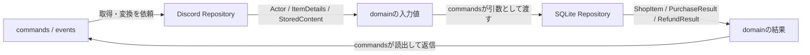
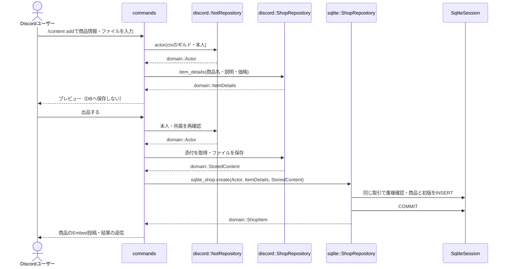

# Repositoryとデータの受け渡し

DiscordとSQLiteに、それぞれ具体型のNotRepository・ShopRepositoryを置く。各Repositoryはデータの取得・変換・保存を担当し、他のRepositoryを参照しない。`commands`／`events` が両者を別々に呼び、ドメインの値を受け渡す。ドメインはデータを保持するだけで、変換・検証・Repositoryの呼び出しは行わない。

矢印はデータの流れを表す。Repository間の直接呼び出しはなく、ドメインにも中継処理を置かない。出品の例：

Discordの `NotRepository` は所属・権限を `Actor` へ、`ShopRepository` は商品入力・ファイル保存結果をドメイン値へ変換する。SQLiteの `NotRepository` はNOTと報酬、`ShopRepository` は商品・公開記録・購入・返金を扱う。接続とSQL取引は既存の `SqliteDatabaseAccess`・`SqliteSession` を使う。共通の値変換はインフラ内の `types.rs` で再利用する。添付・ファイルI/OはDiscord ShopRepositoryのメソッドとして既存の `content.rs` に置く。

DiscordのNotRepositoryが増減額・ギルドID、ShopRepositoryが商品ID・購入ID・ロールID・商品版を解析し、検証したドメイン値をcommandsへ返す。共通の変換はRepository内部から再利用する。domainのフィールドは非公開で、内部の生成メソッドは検証済みの値を格納する。既存値を直接書き換える入口は公開しない。

`commands.rs` では `sqlite_not`・`sqlite_shop` がSQLiteのRepository、`discord_shop` がDiscordの商品Repositoryである。Poiseの親コマンド `content` はサブコマンドの入口で、処理は `add`・`update`・`delete` などに置く。`add` は変換済みの `ItemDetails` を下書きへ保持し、確定ボタンの `listing_action` がファイル保存→`sqlite_shop.create`→公開・返信を行う。取消や期限切れでは保存しない。

返信・購入確認・ロール操作は `commands.rs`、Gateway処理は `events.rs` に書く。Poiseの `Data` にRepositoryと対話状態を保持し、その対話処理をcommands／eventsに実装する。追加の中間層やTraitは置かない。

## NOT

| 操作 | 内容 |
|---|---|
| `get_balance`・`get_ranking` | ギルド別の残高VIEWを取得。履歴なしは0。同額は保存されたユーザーID文字列順。 |
| `adjust_amount` | 管理者が正負の増減額を追記。残高不足・上限超過を拒否。 |
| `adjust_balance` | 非負の目標残高との差額を追記する既存API。Discordのコマンドは `adjust_amount` を使う。 |
| `transfer` | 100・500・1000 NOTを2行で一括移動。自己譲渡を拒否。 |
| `grant_reward` | 投稿5・リアクション実行1・リアクション受信10・返信受信20 NOT。 |
| `grant_voice_reward` | 通話1分ごとに1 NOT、ギルド・ユーザーごとに日本時間の1日300 NOTまで。 |

投稿・リアクション報酬はギルド・受取人・種別ごとに60秒間隔、1日100回まで。日付は日本時間で区切る。Bot・Webhook・自己リアクション・自己返信を除外し、自己返信やBot・Webhookへの返信には投稿報酬も付けない。同じ投稿への同じ人のリアクションは絵文字や付け直しによらず1回。制限による見送りも記録し、再配信で付与し直さない。

通話はミュート・1人でも対象とし、退出時の1分未満を切り捨てる。退出・切断では計測を終了し、停止中の時間を遡って付与しない。Botは通話へ参加しない。付与失敗時は同じ獲得時刻で照合する。

## 商品と売買

| 操作 | 内容 |
|---|---|
| `create` | 保存済みの `StoredContent` と商品情報を登録。同じ保存キーの再試行は元の商品を返す。 |
| `create_role` | 管理者が既存ロールを商品登録。ギルド・ロールと初版で再試行を照合。 |
| `find`・`list` | 対象ギルドの販売中商品を取得。 |
| `get_publication`・`record_publication` | 出品者本人を照合し、削除版を含む商品と公開記録を取得・追記。Discordの投稿処理はcommandsで行う。 |
| `update`・`delete` | 出品者本人と期待する版を照合し、新版・削除版を追記。 |
| `prepare_purchase` | 本人・ギルド・商品版・価格に結び付いた5分間の確認を作る。課金しない。 |
| `purchase` | 確認と最新状態を照合して決済。コンテンツは同額の売上も一括確定し、ロールは購入者の減算だけを記録。 |
| `find_purchase_by_confirmation` | 確認IDから元の結果を復元。返金済みでも再課金しない。 |
| `list_purchases`・`get_purchase` | 未返金購入の一覧・領収結果を取得。 |
| `get_content_for_purchase` | 本人・ギルド・未返金を照合し、固定のファイル情報を返す。 |
| `refund` | 管理者が元の購入額を返金。元の売上がある場合だけ売上取消も一括確定。 |

商品のギルド・出品者・ファイルは固定。変更・削除でも過去の版と完成ファイルを保持する。コンテンツの自己購入は禁止。ロールは出品者本人も購入でき、本人にも代金を課す。ロールの代金は誰にも加算せず、出品者の残高に依存しない。`PurchaseResult`・`RefundResult` の `seller()` は `Option<&LedgerEntry>` で、新しいロール購入・返金では `None`。旧仕様の売上付き購入は履歴を保持し、復元・返金も元の記録に従う。利用者向けの流れは [CONTENT.md](CONTENT.md)を参照する。

ロール操作は `discord/commands.rs` で権限・階層・保有を確認する。未付与を確認できた場合だけ `refund_role_delivery` で元額を返金し、不明・返金不能なら未返金の権利を残す。起動時は `list_role_purchases` で未返金購入を照合する。管理者返金はロール解除を確認してから確定し、不成立なら元の権利に基づいて再付与を試みる。

## 取引境界

`begin_read` は照会、`begin_write` はSQLiteのImmediateトランザクション。同じ `SqliteSession` で現在状態を照合し、必要な行をINSERTして `commit` する。SQL失敗・破棄・キャンセルでは全体を取り消し、失敗後の確定を拒否する。Discord APIとファイルI/OはDB取引の外で行う。

再試行は同じ依頼IDと内容を使う。`event_key` はギルド内で一意で、購入・返金・譲渡の両側を区別する。ロール購入・返金は購入者側だけを作る。COMMIT結果不明も既存IDで照合し、新しいIDで重複処理しない。コンテンツ売買の片側欠落など、不整合な履歴は補完せず拒否する。

金額はchecked演算し、実際に増減する利用者の残高不足・上限超過を確認する。返金は現在価格ではなく元の購入額を使う。元の売上がある場合は出品者の残高不足でも全体を取り消し、売上なしのロール購入は出品者の残高を確認・減算しない。返金後の無料再送は拒否する。

行からの変換はSQLiteの各Repository、DBエラー変換は `sqlite/database.rs`、操作上の失敗は `RepositoryError` に置く。`DatabaseError` は競合・不正データ・読取専用・利用不能・確定結果不明を区別する。これらは再試行や金額の整合性に必要な分類であり、通常の伝播は `?` に任せる。

SQL・索引・一意制約・公開記録は [DATABASE.md](DATABASE.md)を参照する。

購入結果と返金結果の生成は `sqlite::shop::ShopRepository::purchase_result`・`refund_result` に集約する。不一致な元取引・本人・ギルド・金額・片側欠落は拒否する。新規処理のCOMMIT前と履歴の復元で共用し、検証なしに結果を組み立てる経路は持たない。
