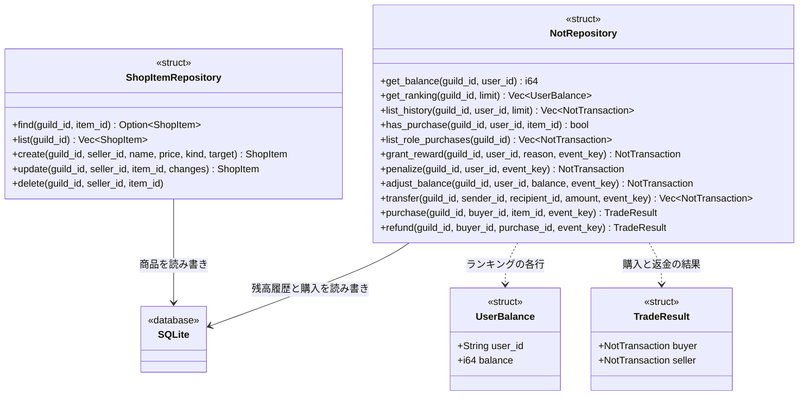
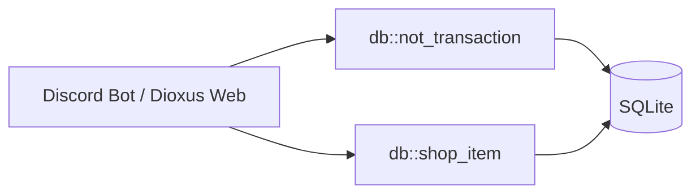

# リポジトリ設計

[DB設計](DATABASE.MD)に対応する、BotとWebで共有するSQLite向けの設計。Rustの `struct` と `impl` をMermaidのクラス図で表す。

売買は購入者から出品者へ同額のNOTを移すユーザー間売買とする。DiscordとNOTストアの両方で同じ `NotRepository` を使用する。

## リポジトリと操作



`NotTransaction` と `ShopItem` はDB設計の各行に対応するデータ用struct。`UserBalance` はランキングの取得結果、`TradeResult` は購入者・出品者の2行の履歴をまとめた戻り値で、専用テーブルは作らない。図の戻り値は正常時の型を示し、実装では `Result<T, Error>` とする。`delete` の正常時は `()`。Discordのサーバー・ユーザーIDは `String`、商品・取引IDとNOTの値は `i64` とする。

## 利用箇所と操作

| 利用箇所 | 操作 | 呼び出すAPI |
|---|---|---|
| Discord・NOTストア | NOT残高の確認 | `NotRepository.get_balance` |
| Discord | 投稿・リアクションの報酬 | `NotRepository.grant_reward` |
| Discord | タイムアウトによる減算・専用リアクションでの譲渡 | `NotRepository.penalize`・`transfer` |
| Discord | サーバー内の残高ランキング | `NotRepository.get_ranking` |
| NOTストア | 商品の作成・表示・更新・削除 | `ShopItemRepository.create`・`find`・`list`・`update`・`delete` |
| NOTストア | 売買による購入者・出品者の残高変更、返金 | `NotRepository.purchase`・`refund` |

## 責務と整合性

| リポジトリ | 責務 |
|---|---|
| `NotRepository` | 最新行からの残高取得、サーバー別ランキング、履歴照会、報酬・罰則・残高調整・譲渡・購入・返金。購入処理内では商品を、履歴照会では取引理由名を必要に応じてJOINする。 |
| `ShopItemRepository` | 商品の作成・照会・更新・論理削除。購入済み商品も履歴から解決できるように保持する。 |

- 残高を変える操作は、同じ接続の `BEGIN IMMEDIATE` 内で重複確認・残高や参照元の取得・検証・INSERTまで行う。通常の報酬・譲渡・決済では、呼び出し側が算出した残高をそのまま保存しない。
- `grant_reward` は `MESSAGE`・`REACTION`・`REACTION_RECEIVED`・`REPLY_RECEIVED` を受け付け、既定の報酬額を加算する。回数・間隔など履歴に依存する制限も同じトランザクション内で確認する。Bot・自己操作の除外は呼び出し側で行う。
- `penalize` は100NOTを上限として0NOTまで減算する。`adjust_balance` は管理者が指定した非負の残高を新しい履歴として記録する。管理者権限は呼び出し側で確認する。
- `transfer` は100・500・1,000NOTのいずれかを受け付け、自己譲渡と残高不足を拒否する。送信者・受信者の2行をまとめてINSERTし、`event_key` に `:sent`・`:received` を付ける。返す履歴もこの2行。
- `purchase` は同じトランザクション内で商品のサーバー・未削除であること・出品者・現在価格・未返金の購入履歴・購入者の残高を確認する。自己購入と残高不足を拒否し、購入者の減算を `PURCHASE`、出品者の同額加算を `SALE` として記録する。売上行の `sale_of` は購入行のIDを参照する。出品者と価格はDBから取得し、事前に呼んだ `find` や `has_purchase` の結果だけで決済しない。
- `refund` は元の購入が同じサーバー・購入者の `PURCHASE` であることと、対応する `SALE`・出品者を確認する。購入時の残高差から金額を復元し、購入者へ `REFUND`、出品者へ `SALE_REFUND` を記録する。各行の `refund_of` は、それぞれ元の購入行・売上行を参照する。返金行の `item_id` と `sale_of` はNULLとする。出品者の残高不足時は両者の残高を変えずエラーとする。
- 購入・返金の2行はまとめてINSERTし、`TradeResult` として返す。手数料は設けず、両者の増減額の合計を0にする。
- 各書き込みは再試行時も同じ `event_key` を使い、処理済みなら既存の結果を返す。返金元が処理済みの場合も二重返金しない。失敗したトランザクションは全体をロールバックする。
- `has_purchase` は返金されていない購入の有無を返す。`list_role_purchases` は未返金のロール購入を返し、Bot再起動時のロール照合・再付与に使う。
- Discordへのロール付与は購入のCOMMIT後に呼び出し側で行い、失敗時は `refund` を試みる。出品者の残高不足で返金できない場合はエラーを運営の対応対象とし、ロール付与の復旧または出品者との精算を行う。即時返金を保証するには、売上の保留を別途設計する必要がある。DBトランザクション中にDiscord APIを呼ばない。
- 全接続で外部キーを有効にする。`transaction_reason` の固定コードと表示名は初期SQL・管理SQLで管理し、専用リポジトリは追加しない。

## 商品の更新・削除

- `create` は認証済みの出品者IDを `seller_id` に設定して新しい商品を登録する。`list` は指定サーバーの `deleted_at IS NULL` の商品のみを返す。
- `find` はサーバーIDと商品IDで取得し、過去の購入内容を解決するため削除済み商品も返す。公開表示時は呼び出し側で `deleted_at` を確認する。
- `update` の `changes` は商品名・価格・種別・取得先の変更内容を表す。商品名と正の価格は更新可能。種別・取得先の変更は購入履歴のない商品に限り、サーバーIDと出品者IDは固定する。削除済み商品への更新は拒否する。
- `delete` は `deleted_at` に日時を設定する論理削除。再実行も成功として扱い、商品一覧と新規購入から除外する。購入履歴・既存の閲覧権・返金元は保持する。
- 更新・削除は `(guild_id, seller_id, item_id)` で出品者自身の商品に限定する。認証済みユーザーのIDを使い、出品者・購入者IDをリクエスト本文から信用しない。出品するコンテンツやロールへの操作権限は呼び出し側で確認する。
- 更新・削除の対象取得と検証も同じDBトランザクション内で行う。購入と更新・削除を直列化し、途中の状態で決済しない。

## ランキング

サーバーごとに、履歴のある各ユーザーの最新行だけを選び、残高の降順で返す。同額ならユーザーIDの昇順とする。過去の残高の合計や最大値は使わない。

```sql
WITH latest AS (
    SELECT MAX(id) AS id
    FROM not_transaction
    WHERE guild_id = ?
    GROUP BY user_id
)
SELECT t.user_id, t.balance
FROM not_transaction AS t
JOIN latest ON latest.id = t.id
ORDER BY t.balance DESC, t.user_id ASC
LIMIT ?;
```

## Rustでの代替案

クラス図は必須ではない。DB接続を引数に取る関数を `db::not_transaction` と `db::shop_item` にまとめる構成でも、同じAPIとトランザクション境界を表現できる。構成を共有するだけなら、次のモジュール図で足りる。



接続を保持する `struct` を使うなら上のリポジトリ案、関数として実装するならモジュール案を選ぶ。どちらも具体的なSQLite実装から始め、共通traitや汎用CRUDリポジトリは現時点では追加しない。
