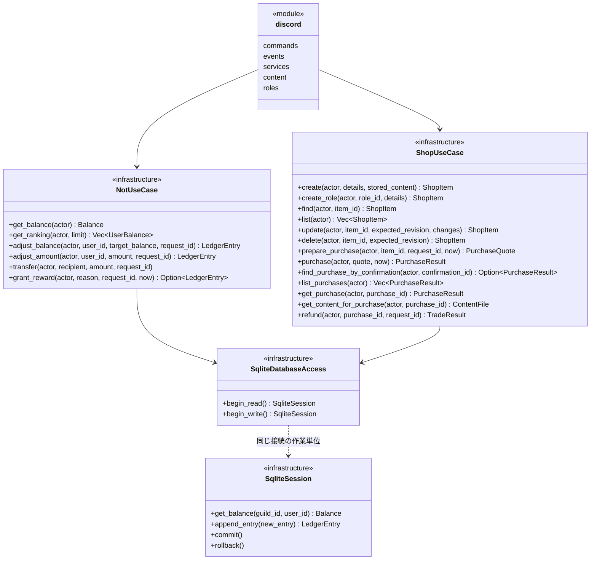

# インフラの操作処理とDBアクセス

[2層のアーキテクチャ設計](ARCHITECTURE.md)に従い、ドメインは共通の値・商品・取引・結果を保持する。Discord、操作の実行、DBアクセス、ファイルI/Oはすべてインフラに置く。独立したアプリケーション層・Repository層は作らない。[DB設計](DATABASE.md)と[コンテンツ売買](CONTENT.md)の仕様は引き継ぐ。

コードも2層へ移行済み。操作メソッド・検証・取引境界は既存実装を再利用し、`src/application/` と単一DB実装のためのTraitは削除した。

## 処理のつながり



図のモジュールと処理structはすべて同じインフラ層のもの。操作処理とDBアクセスは `sqlite/`、Discordの入力・認証・返信は `discord/` に配置する。引数・戻り値にはドメインの型を使う。`NotUseCase`・`ShopUseCase` は既存の操作集合の名前を維持し、具体的な `SqliteDatabaseAccess` を受け取る。DB向けの型引数とTraitを介さず、具体型の通常メソッドを使う。`SqliteSession` の図には代表的な操作だけを示す。

I/Oは非同期の `Result<T, ...>` とする。公開・配送は確定後にDiscord処理が行う。P08の出品・公開・再投稿とP09の購入確認・決済・配送・無料再送、P12の報酬・罰則・譲渡、P13のロール登録・販売・照合・復旧は実装済み。空のTrait・DTO・メソッドは作らない。

## DB操作で守ること

- 照会は `begin_read`、状態の照合と追記は `begin_write` で始め、返された同じ `SqliteSession` を使う。SQLiteの書込みはImmediateとし、残高確認から複数行のINSERTまで直列化する。
- `begin_read` からの追記は `DatabaseError::ReadOnly` として拒否する。商品や残高の変更もINSERTと履歴で表し、UPDATE・DELETE・REPLACEを使わない。
- 正常時だけCOMMITし、途中失敗・未確定の破棄・キャンセルは全体をROLLBACKする。確定・取消でセッションを消費し、失敗後の接続を未処理のまま再利用しない。
- COMMIT中のキャンセルやI/O障害では、確定済みの可能性を `OutcomeUnknown` として扱う。同じイベントキーで結果を照合し、新しいキーで再課金しない。
- SeaORMのモデル・SQL・接続型はインフラ内に置く。取得値からその場でドメイン型を生成し、価格・残高・IDなどを検証する。同じ内容のRow用DTOやMapperを追加しない。

この保証はTraitの有無によらず維持する。既存の取引所有・失敗時の全体取消・実SQLiteの検証を再利用する。

## 残高と取引

- `get_balance`・`get_ranking` は `not_balance` VIEWを照会する。履歴なしは0、負の集計値や整数オーバーフローは不正データ・算術エラーとして扱う。
- `grant_reward` は既定の報酬額と回数・間隔の条件を判断する。Bot・自己操作の除外に必要な情報はDiscord側の入力変換で渡す。履歴に依存する制限は同じ書き込みセッションで確認する。
- `adjust_amount` は正負の指定額をそのまま追記し、増減後の残高が負数・整数上限超過なら拒否する。`adjust_balance` は非負の目標残高との差額を追記する。0の追記もイベントの処理済み記録に使う。いずれも管理権限を確認する。
- `transfer` は100・500・1,000NOTのいずれか。自己譲渡・残高不足を拒否し、送信者・受信者の増減の合計を0にする。
- `prepare_purchase` は同じサーバー・販売中・自己購入でないこと・未購入・購入可能な残高を確認し、本人・ギルド・商品版・価格・確認ID・期限を持つ `PurchaseQuote` を返す。ここでは課金しない。
- `purchase` は確認IDによる確定済み結果を先に照合する。初回だけ期限・商品版・価格と最新状態の一致、残高等を再検証する。確認した同額で購入者の負数行と出品者の正数行を追記し、売上の `sale_of` に購入行のIDを渡す。
- `find_purchase_by_confirmation` は本人・ギルドと確認IDのイベントキーを照合して確定済み結果を返す。再起動で未決済の確認が失われた場合にも使う。返金済みの結果を返しても再課金はせず、再送権限は別途確認する。
- `refund` は元の購入と売上を取得し、それぞれの金額の符号を反転する。出品者の残高不足時は両行とも追記せず失敗させる。現在の商品価格は使わない。
- 加減算・符号反転はchecked演算を使う。受取側も含め、増減後の残高が0以上かつ表現範囲内であることを確認する。
- `event_key` は操作種別と依頼IDを含め、譲渡を `:sent`・`:received`、購入・返金を `:buyer`・`:seller` で区別する。処理済みなら依頼の主体・商品・金額と一致する既存の結果を返す。

`NotUseCase` の残高・ランキング・調整を実装している。調整は管理権限を確認した後、`begin_write` → `adjust:{request_id}` の照合 → 現在残高の取得 → 差額の追記 → COMMITの順で行う。`target_balance` は `Balance` 型で受け取り、負数は生成時に拒否する。依頼IDは空白だけの値・制御文字を拒否する。同一キーの対象ユーザー・理由が異なる場合は `UseCaseError::RequestConflict` とする。

`adjust_amount(actor, user_id, amount, request_id)` は管理権限を確認し、`adjust-amount:{request_id}` の元取引の対象・理由・指定額を照合する。未処理なら現在残高へ `NotAmount` をchecked加算し、`ADJUSTMENT` として追記する。照合・残高検証・追記は同じImmediateトランザクションで行い、後続の残高変更後も同じ依頼は元の結果を返す。Discordの管理操作は `/not adjust amount:正負の整数` に統合し、`/not penalize` と固定100 NOTの罰則処理は削除した。旧 `TIMEOUT`・目標残高調整の履歴は書き換えない。

`transfer(actor, recipient, amount, request_id)` は `transfer:{request_id}:sent`・`:received` の両行を照合し、送信・受信の順の `(LedgerEntry, LedgerEntry)` を返す。別の主体・対象・金額へのID再利用を拒否し、片側しかない履歴は `InvalidData` とする。Discordは `/not transfer` から接続し、対象所属をRESTで照合する。

`grant_reward(actor, reason, request_id, now)` は投稿5・リアクション実行1・リアクション受信10・返信受信20 NOTを付与し、サーバー・受取人・種別ごとの60秒間隔と日本時間の日次100回上限を判定する。`reason` はこの4種別だけを許可する。Botで採取した `SystemTime` を使い、時刻用Traitは追加しない。`reward:{reason.code()}:{request_id}` と `reward_event` で付与・見送りを復元し、付与なら `Some(LedgerEntry)`、制限なら `None` を返す。旧仕様の一律1 NOTも正当な保存済み結果として照合し、現在の額で付与し直さない。見送りも確定して記録し、日付変更・再起動後に同じイベントを付与し直さない。処理済み確認・上限・残高検証・取引と結果の追記は同じ書き込みセッション内で行う。Discordの `rewards.rs` はメッセージID、リアクションではメッセージIDと実行者IDを渡し、REST所属確認とBot・Webhook・自己操作の除外を担当する。各受取人の報酬は独立した判断・取引とする。

調整の履歴には目標残高そのものではなく差額を保存するため、再試行時は `get_balance_at_entry` で元取引のIDまでの同一ギルド・ユーザーの履歴をID順に集計し、当時の目標残高を照合する。一致すれば元の `LedgerEntry` を返し、不一致なら `RequestConflict` とする。後続の取引やBot再起動があっても再反映しない。IDは追記順に採番し、上限到達後の追記は拒否する。新しい依頼管理テーブルや目標残高列は追加しない。

`UserBalance` はユーザーIDと検証済みの残高を持つドメインの結果型。入力検証・金額・DBの失敗は `UseCaseError` で区別する。DB内の不正なID・負の残高・集計オーバーフローを入力不正として扱わず、`DatabaseError::InvalidData` として返す。

購入の順序は、認証済みの確認操作 → `begin_write` → 確認IDでの重複確認 → 最新商品と両者の残高VIEW取得 → 確認した価格・版・期限・業務条件・算術の検証 → 購入・売上のINSERT → COMMIT。VIEWを読む前からトランザクションを開始する。INSERT方式でも、片側だけの確定と同じ残高に対する競合を防ぐ必要がある。

P05の `prepare_purchase`・`purchase` は受付時のサーバー時刻 `now: SystemTime` を受け取る。呼び出し側が `SystemTime::now()` で採取し、Discordの入力値を採用しない。時計用Traitは追加しない。`PurchaseQuote` は外部から生成・変更できない型で、確認ID・購入者・確認時の `ShopItem`・期限を保持する。ギルド・商品版・価格はその商品のスナップショットを参照し、同じ情報を重ねて保持しない。期限は発行受付時刻＋300秒、未処理なら期限ちょうどで拒否する。

`has_purchase` は同じギルド・購入者・商品に対する未返金の `PURCHASE` を `EXISTS` で照会する。`REFUND` は元購入の参照・ギルド・購入者が一致するものを対象にする。確認発行と初回決済の両方で使う。既存の残高照会・イベントキー照合・履歴追記・取引境界を再利用する。

決済の再試行では購入・売上の両キーを取得し、ギルド・購入者・出品者・商品・金額・`sale_of` を照合してから元の結果を返す。不一致は `RequestConflict`、片側だけの履歴は `DatabaseError::InvalidData` とし、足りない行を補完して決済を続けない。両行が確定済みなら、期限・現在価格・販売状態・残高・返金状態による初回の可否判定を繰り返さない。

`PurchaseResult` は購入・売上の2行と現在の商品を直接保持する。支払額は購入履歴の増減額から取得し、商品の現在価格を使わない。返金済みでも同じ確認IDの領収結果は返せるため、この型だけを配送権限にしない。

P06の `find_purchase_by_confirmation` は確認IDの両キーを照合し、本人なら領収結果、両行がなければ `None` を返す。返金状態にかかわらず元の取引を復元できる。購入・売上の片側欠落や、サーバー・出品者・金額・参照の不一致は `InvalidData` とする。

`list_purchases` は既存の `PurchaseResult` の一覧を返し、重複する `PurchasedItem` 型は作らない。DBの `list_purchase_entries` は本人・ギルドの購入行を返金済みも含め購入ID降順で返す。操作処理で売上・商品・返金の両行を照合して未返金の購入だけを返す。`get_content_for_purchase` も同じ照合を使い、本人の未返金購入だけから固定の `ContentFile` を返す。商品変更・削除は購入権限を失わせず、権限の照会と結果復元はINSERTしない。

返金の認可は既存の `Actor.can_manage_not` に限定する。`refund(actor, purchase_id, request_id)` は管理権限 → 元購入・売上の照合 → `refund:{request_id}:buyer`・`:seller` の再試行照合 → 既存返金の確認 → 両者の残高と算術 → `REFUND`・`SALE_REFUND` の追記 → COMMITの順で処理する。同じID・同じ元購入の再試行は元の返金を返す。別の購入へのID再利用は `RequestConflict`、別IDでの二重返金は `AlreadyRefunded`。現在の商品価格は使わない。出品者の残高不足・購入者の残高上限超過では一切追記しない。履歴の片側だけを補完したり、DM配送失敗を受けて自動返金したりしない。

取引行の取得と購入・売上の整合性照合は、既存の共通関数を再利用する。SeaORMのSQLには値をバインドし、文字列として埋め込まない。

## 商品・取引理由の履歴

- `append_content_item` は保存済みの `ContentFile` と商品の固定情報・初版を同じセッションでINSERTする。出品者とギルドは `Actor` から設定する。入力は既存の `NewShopItem` を使い、CONTENT以外は受け付けない。
- `find_item` は `current_shop_item` から削除済みを含む最新状態を返す。`list_active_items` は `deleted_at IS NULL` だけを返す。一般閲覧は販売中、購入者の閲覧・返金・ロール照合は削除済みも対象にする。
- 商品変更は出品者本人と `expected_revision` の一致を確認し、商品名・説明・価格を変更した次の版を `append_item_revision` でINSERTする。古い画面からの変更は競合として返す。固定のサーバー・出品者・種別・取得先は変えない。
- 削除も `append_item_revision` で最新の名前・説明・価格を引き継ぎ、削除日時を持つ次の版をINSERTする。既に削除済みなら成功とし、以後の変更・新規購入は拒否する。過去の版と取得先は保持する。
- 商品作成の再試行は固定情報の一意制約、版追加の再試行は期待する版番号と確定済みの内容を照合する。結果不明時に次の版を無条件で追記しない。
- 理由マスタは初期SQL・運営の管理SQLで、固定コードと表示名の履歴を追記する。現時点では利用者向け操作処理や専用Repositoryを作らない。

作成の入口は `create(actor, details, stored_content)` とする。`StoredContent` は外側の保存処理だけが生成するインフラの保存成功を表す型で、保存した実行者・ギルドとファイル情報を持つ。配置は `infrastructure/stored_content.rs` とし、`mod.rs` から再公開してSQLite側とDiscord側で共有する。操作処理は対象の一致と配送サイズを検証し、内部で既存の `NewShopItem` を組み立てる。任意のメタデータだけで未保存のキーを登録する入口を設けない。

`find_content_item` はギルド・保存キーから削除済みを含む最新の商品を返す。作成の再試行では、`find_item_revision(..., 1)` で出品者・ファイル情報・初版の名前／説明／価格を照合する。一致すれば現在の商品を返し、不一致は `RequestConflict`。後から変更・削除されていても作成や復活をしない。

変更は出品者とギルドを照合後、期待する版と最新の版が一致した場合に次の版を追記する。不一致でも、期待する次の版が既に存在し、削除版でなく内容も同じなら、その版を返して再追記しない。それ以外は `RevisionConflict`。削除は期待する版を照合し、既に削除済みなら所有者確認後に成功として返す。通常の `find`・`list` は販売中だけを返し、DBの `find_item` は購入権限等に備えて削除済みも返す。

ファイルI/OはDBセッションの開始前に完了する。保存処理は [content.rs](../src/infrastructure/discord/content.rs) の具体関数で、標準ライブラリだけを使う。同期I/OはDiscordの非同期処理から `spawn_blocking` で呼ぶ。完成ファイルを削除するDrop処理は置かず、DBエラー・結果不明時にも保存キーで再試行できるようにする。

## Discordとの境界と配送

`discord/commands.rs` がPoiseのコマンド定義と操作処理の呼出し、`services.rs` が入力変換・認証・ギルド候補、`events.rs` がイベントと共通のエラー返信を担当する。P10の `posting.rs` は添付受信・サーバー選択・フォームを `listings.rs` の既存プレビューと公開処理へ接続する。P11の `management.rs` は `/content` の商品変更・削除・再投稿・返金をP04・P06へ接続し、公開表示の同期を `listings.rs` へ任せる。これらはすべてインフラ内の処理であり、ドメインには変換済みの値と結果だけを置く。購入確認は本人と元のギルドへ結び付け、公開EmbedとDMの確認・配送を分ける。

`discord/` が操作処理を呼び、確定後の結果を使って公開・配送する。ロール操作もインフラのSerenity呼出しで実行し、追加のTraitや循環した所有構造は作らない。

- `TradeResult` は返金の購入者・出品者の2行、`PurchaseResult` は確定した購入・売上と現在の商品を持つ。P09で扱うコンテンツの配送結果は送信後に `discord/` が扱い、課金済み状態と配送保留を区別して表示する。譲渡は2行の履歴を返す。
- ロール付与はCOMMIT後にSerenityで実行する。結果不明なら保有状態を照合して再試行し、DBトランザクション中は外部APIを呼ばない。
- コンテンツは `get_content_for_purchase` で購入者・同じギルド・未返金を照合し、固定の保存キーを返す。`discord/` がCOMMIT後に添付送信する。送信失敗・結果不明は配送保留と購入IDで案内し、購入一覧から無料で再送できるようにする。自動返金はしない。
- ロール配送失敗時は従来どおり返金を試み、返金できなければ配送保留として再照合する。コンテンツの返金は認可された明示操作で行う。即時返金の保証には売上保留が別途必要となる。

P13の `create_role` は管理者のみ受け付け、ギルド・ロールIDの既存商品と初版を照合して再試行を復元する。変更・削除・確認価格・購入はコンテンツと同じ操作を使う。`get_purchase` は購入者本人または管理者だけに、未返金の購入・売上・商品を返す。ファイル取得は引き続き購入者本人だけに限定する。

`discord/roles.rs` がSerenityの権限・ロール階層・保有を照合する。未付与を確認した後だけ内部の `refund_role_delivery` を呼び、購入者本人のROLE購入に限定して `refund:role-delivery-{購入ID}:buyer`・`:seller` で元額を返金する。一般ユーザーを管理者Actorへ昇格させない。保有不明なら返金せず、返金不能なら未返金の権利を残す。内部の `list_role_purchases(guild)` は購入・売上・返金を検証し、削除済み商品も含めた未返金ROLE購入を起動時の照合へ渡す。管理者返金ではロール解除を確認してから既存の返金処理を呼び、不成立なら未返金の権利を照合して再付与を試みる。配送・返金・公開の競合は既存の商品単位ロックを共用する。
- 購入権限は返金されていない購入から判定する。削除後も過去の購入・取得先を参照できる。

## エラー

| 型 | 責務 |
|---|---|
| `ValidationError`・`MoneyError` | ドメイン型の不変条件・金額の算術失敗。 |
| `DatabaseError` | `Unavailable`・`Conflict`・`InvalidData`・`ReadOnly`・`OutcomeUnknown`。DB固有のエラーは実装内で記録・変換する。 |
| Discord APIの失敗 | インフラで扱う。SDKの秘密情報を含み得る本文をそのまま返信・ログへ出さない。 |
| `UseCaseError` | インフラの操作処理の失敗。権限不足・残高不足・購入済み・商品なしなど。名前のUseCaseは層を表さない。 |

DBからの検証失敗は `DatabaseError::InvalidData` として入力不正と区別する。返信文はDiscord側の出力処理で決める。

各所で文字列化・分岐せず、DBの分類は `From` に集約し、呼出し側は `?` を使う。エラー表示と標準の変換は `thiserror` で生成する。起動・Discord処理の共通エラーは `Box<dyn Error + Send + Sync>` とし、返信失敗の記録はイベント入口にまとめる。業務エラーで戻る前の明示的なROLLBACKは不要で、未確定セッションの破棄による取消を使う。

## ランキングのSQL

同額なら保存されたユーザーID（TEXT）の文字列昇順とする。例えば同額のID `10` は `2` より先になる。履歴のないユーザーは含めず、0の取引があるユーザーは残高0として含める。`limit` は `u32`、0なら空の一覧。

```sql
SELECT user_id, balance
FROM not_balance
WHERE guild_id = ?
ORDER BY balance DESC, user_id ASC
LIMIT ?;
```


Discord側の公開処理 は保存済みの商品情報からEmbedを組み立てて投稿し、成功したメッセージと商品版を `append_publication` で追記する。`find_publication` は商品の最新公開記録を返し、変更・削除時のメッセージ編集に使う。これらのDB操作は認証済みの公開処理だけから呼び、外部入力をそのまま書き込まない。

公開と配送はDBの取引外で行うため、DBエラーとは別に投稿保留・配送保留を表示する。商品・決済をやり直す代わりに既存IDで再試行する。未決済の下書き・確認の永続化や専用の配送キューは追加しない。
